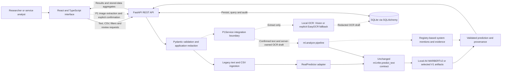

# Academic Implementation and System-Verification Evidence

**Research title:** *Beyond Sentiment: Mining Actionable Service Failures from Arabic Digital Service Complaints Using Machine Learning*

**Purpose:** Evidence for the Methodology, System Implementation, and Results and Analysis chapters of the MSc report. This document describes the implemented system and recorded engineering verification. It does not introduce a new classification experiment, change the application, retrain a model, or rerun a holdout evaluation.

**Evidence cutoff:** Application source and integration records through `035f3ebb193a4a7b0fd8f88bf4e9d521a0f0898b`, inspected on 2026-10-31. Paths below are relative to `integration/app/` unless stated otherwise. References such as [E01] link directly to inspected evidence; Section 12 identifies their provenance. Selected excerpts from locally retained, Git-ignored verification artifacts are preserved in [the documentation evidence snapshot], [E06]. No application tests or inference were rerun for this documentation task.

## 1. Verified implementation status

The latest **fully verified integrated baseline** is the standalone A4 release on `integration/a4-environment` at `3b2c2cf`. It combines the existing web application, real `a4-marbert-v1` inference, persistent storage, previously verified browser workflows, and a self-contained dependency installation. The latest application source is the subsequent P1 checkpoint on `integration/p1` at `035f3eb`, with implementation in `7175581`. P1 is integrated into React and FastAPI and has successful application/API tests, but its complete browser and Apple Vision acceptance remains unresolved. These states must not be described as equivalent. [E01], [E02], [E04], [E05]

| Implementation state | Branch and exact checkpoint | What the evidence supports | Acceptance status |
|---|---|---|---|
| Original real-model integration | `integration/real-ml`, `d835a86` | Integrated V1 classifier; real browser/API/storage verification in the earlier acceptance record; later English-digit UI change | **TESTED**, historical baseline [E03], [E05] |
| A4 application integration | `integration/a4-marbert`, `01f0b43`; implementation `03a006f` | Real MARBERTv2 execution, browser/proxy/database/review flow, model-information display, and live V1 rollback | **TESTED**; original dependency-reference limitation subsequently resolved [E02] |
| Standalone A4 environment | `integration/a4-environment`, `3b2c2cf`; environment implementation `9ea34e0` | Isolated local dependencies, offline A4/V1 execution, passing application/ML tests, actual launcher and proxy startup | **TESTED**; latest fully verified integrated baseline [E01] |
| Integrated P1 extension | `integration/p1`, `035f3eb`; implementation `7175581`; ML subtree merge `afd3bde` | Real text/OCR/system-evidence APIs, persistence and corrections; React interaction tests and production build | **PARTIAL** overall: integrated and application-tested; complete browser/normal-host Vision acceptance **NOT VERIFIED** [E04] |
| Independent Claude P1 delivery | `agent/claude-ml-p1`, `d8ffad4`, source worktree `Project/ml/.worktrees/p1/ml/` | ML delivery reports its own successful test run; its tracked source was imported into the integrated application | An ML-branch result is not independent evidence of web-application acceptance [E39] |

Git inspection confirmed that the integrated `ml/` subtree equals the source tree at `d8ffad4`, and the A4 `ml/infer.py` content is identical to the standalone A4 checkpoint. The original agent branches were preserved. Exact full commit identifiers and inspection commands are given in Section 12 and [E06].

**Status vocabulary used throughout this document:**

| Label | Meaning |
|---|---|
| **IMPLEMENTED** | Present in the inspected source and connected to the application; verification scope must still be stated. |
| **TESTED** | Supported by a recorded test, operational audit, or actual workflow. This does not imply measured model accuracy. |
| **PARTIAL** | Implemented with successful verification of some layers, while a material acceptance step is outstanding. |
| **NOT VERIFIED** | No adequate recorded evidence for the specified claim or environment. It does not necessarily mean the source is absent. |

## 2. Technology stack

The implementation is a local web application with a separate browser frontend, Python backend, and SQLite file. The dependency versions below are extracted from committed locks/manifests, rather than inferred from the version ranges in `package.json`. [E07], [E08], [E09]

| Layer | Implemented technology / locked version | Role | Evidence |
|---|---|---|---|
| Frontend runtime | React and React DOM **19.3.1**, TypeScript **5.9.3** | Components, typed client-side state and rendering | [E07] |
| Frontend toolchain | Vite **8.3.5**, Tailwind CSS **4.3.3** | Development server, API proxy, production bundling, styling | [E07], [E18] |
| Navigation and requests | React Router **7.18.5**; TanStack Query **5.105.0** | Page routes, API request state, cache invalidation after mutations | [E07], [E16], [E17] |
| Charts and icons | Recharts **3.10.1**; Lucide React **0.553.0** | Category/trend charts and interface icons | [E07], [E16] |
| Backend | FastAPI **0.121.2**, Uvicorn **0.38.0** | REST endpoints, typed responses and local ASGI service | [E08], [E10] |
| Validation | Pydantic **2.12.4** | Request, prediction and response validation | [E08], [E11], [E12] |
| Persistence | SQLAlchemy **2.0.44** and SQLite | ORM entities, sessions, transactions, foreign keys and query-based analytics | [E08], [E13] |
| Inference | PyTorch **2.15.0**, Transformers **5.22.0**, Tokenizers **0.23.3**, Safetensors **0.8.0** | Load and execute the exported local MARBERTv2 classifier on CPU | [E08], [E19], [E20] |
| V1 compatibility | scikit-learn **1.9.1**, local joblib pipelines | Preserved baseline model backend | [E08], [E19] |
| OCR extension | Pillow **13.0.0**; PyObjC framework packages **13.0**; optional EasyOCR **1.7.2** | Image validation and local screenshot text recognition | [E09], [E21], [E39] |
| Verification | Pytest **9.2.0**; Vitest **5.0.5**, jsdom **26.1.0** | Backend/ML tests and frontend component tests | [E07], [E08], [E09], [E18] |

The recorded interpreter/toolchain is CPython **3.12.7**, Node **22.20.0**, and npm **10.9.3**. [E48] The complete A4 wheel lock contains **60** pinned distributions; the P1 base lock contains **66**, or **77** with the optional EasyOCR dependency closure. [E49], [E09] The verified wheel target is macOS ARM64 with CPython 3.12; A4 wheels require macOS 14 or newer. Arabic Apple Vision additionally depends on the recognition languages available in the installed operating system. These are tested target constraints, not evidence of validation on every operating system. [E01], [E09], [E30], [E31]

## 3. Architecture

The frontend communicates exclusively with the REST API. Model files and SQLite are accessed by the Python process; the browser does not load weights or call an external inference service. The local launcher starts FastAPI, waits for its diagnostics endpoint, and then starts Vite. The wait establishes backend HTTP readiness; model diagnostics must still be checked because the backend intentionally remains available after a model-loading failure. [E10], [E17], [E19], [E32]



*Figure A. Implemented local application architecture. Solid paths represent the established A4 application architecture; dashed paths identify the integrated P1 extension whose APIs and components are tested but whose complete browser acceptance is pending. OCR extraction stores a draft rather than a classified complaint; confirmed analysis subsequently creates the complaint and its provenance.* [E10], [E13], [E14], [E19], [E21], [E22], [E32]

| Component | Principal source | Responsibility and boundary |
|---|---|---|
| Application shell and routes | `frontend/src/App.tsx` | Arabic/English navigation, data-scope state, page routing, model-mode banner |
| API client and query cache | `frontend/src/api.ts`; page mutations | Typed REST requests; loading/errors; refresh stored-data views after submission/review |
| Text/CSV input page | `frontend/src/pages/Analyze.tsx` | Text submission, optional source/date metadata, CSV import and row report |
| Screenshot interaction | `frontend/src/components/ScreenshotAnalysis.tsx` | Preview, extraction, OCR correction, context input and explicit classification confirmation |
| REST layer and schemas | `backend/main.py`, `schemas.py`, `p1_schemas.py` | Endpoint routing, validation, typed responses and explicit error handling |
| Legacy predictor adapter | `backend/services/classifier_adapter.py` | Real/Mock boundary, startup warmup, validation of the frozen prediction contract |
| P1 integration service | `backend/services/p1.py` | Server-owned drafts, OCR asset checks, real wrapper invocation and atomic provenance persistence |
| Local inference / wrapper | `../ml/infer.py`, `../ml/analyze.py` | Cached trained-model execution; P1 adds OCR/context/system evidence around the original prediction |
| ORM and audit | `backend/database.py`, `services/ingestion.py` | Persistent records, uniqueness, original/effective values, review corrections |
| Analytics | `backend/services/analytics.py` | Aggregates over stored records with source, scope, system and date filters |

The figure is a source-derived architecture diagram, not a screenshot or a claim of new runtime verification. [E10], [E13], [E14], [E19], [E21], [E22]

## 4. Implemented workflow

### 4.1 Established A4 text and CSV workflow

1. The user enters complaint text or selects a CSV file in React. Optional fields identify the source record/application and its original timestamp. Synthetic inputs can be explicitly marked Demo. [E16]
2. FastAPI validates the request. Application-level patterns redact email addresses, Saudi mobile numbers and national-ID-like digit sequences before classification/storage. This is selective pattern masking, not a guarantee of complete anonymisation. [E10], [E11], [E14]
3. Legacy ingestion constructs a SHA-256 fingerprint. Its context includes Demo/Real status, ingestion source and source application, followed by either the source ID or the redacted content and original date. Existing records are returned as duplicates before prediction. Model version is not part of this legacy fingerprint; model switching does not automatically reanalyse existing records. [E14]
4. `RealPredictor` calls the local `ml.infer.predict_text`, validates its output and records the observed model version. The classifier is loaded once per process and reused. Missing artifacts or incompatible output raise an explicit integration error. [E19], [E22]
5. SQLAlchemy saves the current classification, immutable-through-the-review-path original prediction, source metadata and timestamps. React displays the saved response and invalidates cached queries. [E13], [E14], [E16], [E17]
6. Explorer, Review Queue and the dashboard read persisted records. A human correction changes effective fields and appends a correction entry; it does not retrain the model. [E14], [E15], [E16]

At the standalone A4 release this complete browser → Vite proxy → FastAPI → real model → SQLite → React flow had recorded operational acceptance. In the current P1 checkout, the Real text form invokes the P1 endpoint instead; CSV retains the legacy ingestion route. [E01], [E02], [E16]

### 4.2 Integrated P1 image and text extension

The screenshot extension is implemented; its verification must be described at the API/component level rather than as completed browser acceptance. [E04]

1. The browser previews a selected PNG/JPG/JPEG using a temporary object URL. Selecting another image invalidates the previous draft/approval state. [E40]
2. An explicit extraction action uploads the image to `/api/ocr/extract`. The backend validates the file and executes actual local OCR, redacts the extracted text/lines, and stores a server-owned draft. This step does not run classification or insert a complaint. [E10], [E21]
3. The user sees the original extracted text, can correct it, and can add a description of what they were trying to do. [E40] OCR confidence is an engine score, not measured recognition accuracy. [E12], [E21]
4. A separate confirmation submits the draft UUID, optional corrected text and optional description to `/api/complaints/analyze-p1`. The client cannot submit its own purported OCR result dictionary or a local filesystem path. [E12], [E21]
5. The service calls the actual `ml.analyze` wrapper. Typed description and selected OCR text are combined for classification. Registry matching identifies explicit system mentions and spans in that combined redacted string. These offsets refer to the wrapper's `classified_text`, not to coordinates in the image or to the model's subsequently normalised/tokenised sequence. [E12], [E21], [E23]
6. A usable prediction is persisted atomically with its P1 result. A changed OCR text also creates an `ocr_text` correction entry. No-text output leaves the complaint and prediction null; no fictitious complaint is inserted. The original image bytes are not persisted. [E13], [E21]

Exactly one confirmed system mention may populate the existing aggregate system field. Ambiguous names remain possible mentions; multiple confirmed systems are retained in evidence without choosing a primary system. Human review can subsequently set the effective system name. [E41], [E42] Registry identification means “the text mentions this system”, not “this system caused the failure”. [E21], [E23]

## 5. Backend/API/database details

### 5.1 REST endpoints and contracts

The following routes are defined in the inspected source. OpenAPI is generated from FastAPI's request/response declarations. [E10], [E11], [E12]

| Method and route | Accepted inputs | Actual response model / purpose |
|---|---|---|
| `POST /api/complaints/analyze` | `AnalyzeRequest`: text, optional source ID/app/date, Demo flag | `AnalyzeResponse`: `{message: ComplaintOut, duplicate: bool}`; legacy predictor path |
| `POST /api/complaints/import` | Multipart `file`, form `is_demo` | `ImportResponse`: accepted/duplicate/failed/processed counts, row errors, stopped flag and integration error |
| `GET /api/complaints` | Shared filters; `q`, category, complaint/review flags, page and page size | `ListResponse`: items, total, page, page size |
| `GET /api/complaints/{id}` | Stored integer ID | `ComplaintOut`, including original prediction, effective fields and correction history |
| `PATCH /api/complaints/{id}/review` | `ReviewRequest`: complaint status, category, system name, review flag | Updated `ComplaintOut` and stored correction history |
| `GET /api/dashboard/overview` | Shared scope/source/system/date filters | `OverviewResponse`: stored-message counts, complaint ratio, category/source mix, coverage and optional previous-period comparison |
| `GET /api/dashboard/trends` | Shared filters; day/week/month interval | `TrendsResponse`: selected time basis, interval, missing-date count and observed date buckets |
| `GET /api/systems` | Shared filters | `SystemsResponse`: total complaints, per-system count/share and category counts |
| `GET /api/models/info` | No request body | `ModelInfoResponse`: mode, current/observed versions, runtime status/error, categories and correctly paired source evaluation report |
| `POST /api/ocr/extract` | Multipart PNG/JPG/JPEG `file` | `OCRDraftOut`: `{draft_id, expires_at, ocr}`; no complaint insert |
| `POST /api/complaints/analyze-p1` | `P1Request`: text and/or draft UUID, optional nonblank OCR correction, source/date/Demo fields | `P1Response`: `{message: ComplaintOut or null, duplicate, analysis: P1Analysis}` |

Shared filters distinguish Real/Demo, ingestion source and system, and original-event/import time. The unknown-system selector maps to a null effective system name. Listing uses literal escaped substring search rather than interpreting search characters as wildcards. [E10], [E15]

### 5.2 Six-field prediction contract

The trained-model entry point remains `ml.infer.predict_text(text) -> dict`. Its exact output fields are preserved across V1, A4 and P1. P1 places its additional information around this prediction rather than extending the model's dictionary. [E11], [E12], [E19]

| Field | Contract and implemented meaning |
|---|---|
| `is_complaint` | Boolean decision from the selected model's complaint threshold |
| `complaint_score` | Numeric score or null; A4 returns the temperature-scaled `1 − P(NO)` |
| `category` | `AUTH`, `AVAIL`, `PERF`, `TRANS`, `UX`, `OTHER`, or null for a noncomplaint |
| `category_score` | Numeric score or null; A4 reports `P(category | complaint)` for the selected category |
| `needs_review` | Boolean model review flag; subsequent human workflow may change the effective stored flag |
| `model_version` | Nonblank version identifier, retained with each stored prediction |

In `/api/models/info`, `status=verified` means the backend has observed a successful real model call. It is not a certification of classification accuracy or completion of the P1 browser acceptance gates. [E10]

The Pydantic prediction model rejects extra fields, non-strict booleans, nonnumeric/boolean scores, nonfinite scores and scores outside **[0, 1]**. It enforces null category for a noncomplaint. The actual inference function also returns null category score for noncomplaints. Categories have the following operational labels: authentication/access (`AUTH`), unavailability (`AVAIL`), performance (`PERF`), transactions/payment (`TRANS`), interface/usability (`UX`) and other issues (`OTHER`). [E11], [E19], [E16]

The A4 manifest records a complaint threshold of **0.5** and category-review threshold of **0.9**; its gate-review bounds are both **0.5**, making that interval empty. These are configuration values, not demonstrated accuracy or precision guarantees. In particular, the manifest's `precision_target=0.9` must not be reported as measured 90% precision. [E24]

`ComplaintOut` wraps the prediction with persistent metadata and corrections. The P1 checkout adds nullable `p1_analysis` to this response; this is an additive REST change, not a change to the frozen model contract. Historical records have no automatically generated P1 provenance. [E11], [E12], [E14]

### 5.3 Validation and failure behaviour

| Boundary | Implemented rule | Evidence |
|---|---|---|
| Text | Legacy text must be nonblank; maximum **20,000 characters**. P1 permits omitted/empty typed text only with a draft; combined typed/OCR text has the same maximum. | [E11], [E12], [E21] |
| Source metadata/date | Source ID/app maximum **200 characters**. Missing date remains null; naive supplied dates are interpreted in Asia/Riyadh and converted to UTC. | [E11] |
| CSV | UTF-8/BOM-aware parsing; required `text` header; duplicate headers and malformed rows rejected; maximum **10 × 1024 × 1024 bytes** and **5,000 rows**. | [E10] |
| Image | Allowed filename extensions and decoded PNG/JPEG format; maximum **10 × 1024 × 1024 bytes** and **40,000,000 pixels**. Extreme/decompression-bomb headers are rejected before engine loading. | [E10], [E21] |
| OCR draft | Server UUID, expiry **24 hours**, maximum **100** unexpired drafts; expired drafts removed during later extraction requests. | [E21] |
| Listing | Search maximum **200 characters**; page at least **1**; page size **1–100**, default **20**. | [E10] |
| Review/P1/prediction objects | Unknown fields forbidden on these models. The legacy `AnalyzeRequest` retains Pydantic's default extra-field policy; it should not be described as equally strict. | [E11], [E12] |

Validation failures return **422**; missing complaints/drafts **404**; expired drafts **410**; oversized uploads/OCR text **413**; draft-capacity exhaustion **429**; unavailable model/OCR or OCR engine execution failure **503**. Request-validation responses omit rejected input values. An engine's empty-text result differs from an engine failure. Real inference never silently becomes Mock inference or automatically switches model version. [E10], [E21], [E22]

CSV rows are committed individually. A model failure stops further processing and returns an explicit partial-import result; a successful HTTP response for the import envelope is not evidence that every row was accepted. [E10], [E14]

### 5.4 Persisted entities

The following are actual table/column names, not a proposed schema. [E13]

| Entity | Columns grouped by role | Integrity / interpretation |
|---|---|---|
| `complaints` | Identity/source: `id`, `source`, `source_id`, `source_app`; dates/content: `original_event_time`, `imported_at`, `text_redacted`; current model fields: `is_complaint`, `complaint_score`, `category`, `category_score`, `needs_review`, `model_version`; system/review: `system_name`, `system_evidence`, `system_reviewed`; provenance/deduplication: `is_demo`, `fingerprint`, `original_prediction`, `original_system_name` | Integer primary key; unique fingerprint; check constraint disallows a category on a noncomplaint. Original prediction is JSON; effective classification/system fields can be reviewed. |
| `corrections` | `id`, `message_id`, `field_name`, `old_value`, `new_value`, `corrected_at` | Foreign key to complaint; old/new values are JSON. Changed review fields and explicit OCR edits are audit records. |
| `p1_analyses` | `message_id`, `result`, `image_sha256` | Complaint foreign key is also primary key: at most one P1 record per complaint. `result` stores the validated full pipeline result; image digest is optional. |
| `ocr_drafts` | `id`, `image_sha256`, `result`, `expires_at` | Temporary OCR JSON and digest, not image bytes. Saved P1 provenance does not depend on retaining an unexpired draft. |

SQLite foreign keys are enabled and busy timeout is **5,000 ms**. SQLAlchemy creates tables with `create_all`; there is no versioned migration framework. The P1 upgrade adds tables without rewriting the existing complaint/correction schema. A stored migration probe preserved the original **9** Demo records, and the preservation snapshot also retained **3** correction rows with no Real/P1/draft probes in the normal database. These are development-data preservation observations, not research sample sizes. [E13], [E06]

Original prediction/provenance immutability is enforced by the application update path, not by immutable database storage, database triggers or a cryptographic audit ledger. The code separates original and effective values and commits review changes with their correction entries. [E14], [E21]

P1 deduplication additionally includes model identity, input/correction/context, image digest and OCR provenance, excluding elapsed OCR timing. An identical reupload can therefore return the stored analysis, while an explicitly changed correction or model version can create a distinct analysis. This differs from legacy CSV/source-ID deduplication and must not be described as global semantic duplicate detection. [E14], [E21]

## 6. Frontend functionality

The interface is a real React application, not a generated static mockup. Its principal page routes are `/`, `/analyze`, `/complaints`, `/systems`, `/review` and `/model`. Arabic controls use RTL and English controls use LTR; language preference is stored locally. [E43] Arabic complaint/category/system content is retained during English browsing. Generated numbers use English digits and timestamps use the Gregorian calendar with Riyadh time. [E16], [E25]

| Feature | Implemented behaviour | Status and verification boundary |
|---|---|---|
| Arabic RTL and English browsing | Language toggle, direction change, local preference; local Arabic font | **TESTED** in A4 browser records and current component tests [E02], [E26] |
| Complaint text submission | Real-mode P1 request in the current checkout; explicit legacy Mock flow | **TESTED** by current API/component tests; complete current P1 browser flow **NOT VERIFIED** [E04], [E16], [E17] |
| Classification/category/scores | Stored complaint status, category, original scores, review flag and model version | **TESTED** with real A4 browser and API evidence; scores are not accuracy metrics [E02], [E27] |
| CSV import | File selection, Demo flag, row-level acceptance/duplicate/error report | **TESTED**, including recorded actual browser imports and reimports [E02], [E03] |
| Dashboard | Stored-message/complaint totals, category distribution, system ranking, date trends, source mix and completeness | **TESTED** for baseline; P1 image-source additions tested at API/component/build level [E02], [E04], [E15] |
| Time-basis control | Original publication/event dates or actual import dates; day/week/month grouping | **TESTED**; absent original dates are not fabricated [E02], [E15], [E27] |
| Explorer | Search, category/system/review/source/date filtering, pagination and details | **TESTED** in baseline workflows and current API tests [E02], [E10], [E26] |
| Systems Analytics | Effective system/category counts, shares and drilldowns | **TESTED** for stored-data aggregation; this is not outage detection [E15], [E16] |
| Review Queue | Effective classification/system changes, original prediction display and audit history | **TESTED**, including persistence across restart [E02], [E04], [E27] |
| Model Information | Active/observed versions, load diagnostics and paired original evaluation report | **TESTED**; evaluation is displayed, not computed by React [E02], [E10], [E26] |
| Screenshot preview and editable OCR | Preview, extraction, original text, editable text, optional context, separate confirmation | **PARTIAL** end-to-end: implementation, real APIs and component tests pass; real browser/visual acceptance outstanding [E04], [E21], [E26] |
| System evidence display | Confirmed names, quoted spans, possible mentions, generic references and registry version | **TESTED** at P1 API/component level; browser acceptance **NOT VERIFIED** [E04], [E23], [E26] |

Dashboard statistics concern **effective stored classifications**, including any human changes. “No further review required” does not establish that a human reviewed the record. System shares describe the selected complaint records; they do not measure system availability, failure probability, affected-user population or service usage. [E15], [E16]

For undated AURA records, the original-event trend omits unassignable dates and exposes a missing-date count. Import-time charts describe ingestion activity, not when the service problem occurred. The missing-date count retains source/system/data-scope conditions but intentionally does not assign those records to a selected date range. [E15], [E27]

## 7. ML and OCR integration status

### 7.1 Local MARBERTv2 and V1 adapter

A4 uses an exported MARBERTv2 sequence classifier with labels `NO` and the complaint categories. The inference backend is `hf-7way`; it maps the distribution to the original complaint-gate/category contract. The selected export is `a4-marbert-v1` / `E4_marbert_synth_s42`. The local loader reads the exported tokenizer/configuration/weights, runs on CPU and applies the stored temperature. Model loading is cached under a process-wide lock. [E19], [E20], [E24]

The export metadata sets temperature **1.65** and maximum token length **128**. [E44] Accepting a longer application string does not establish that the classifier processes all its content: tokenisation truncates according to this model limit. A4 score semantics and configuration are distinct from a new empirical accuracy measurement. [E20], [E44]

`ML_ARTIFACT_DIR=ml/artifacts/a4/export/a4-marbert-v1` selects A4. Removing that setting from both the launcher file and caller environment, then restarting, selects the original `tfidf-baseline-v1` artifacts. This is an explicit rollback procedure, not an automatic failover on model error. Records retain their original versions and are not silently overwritten. [E19], [E22], [E32]

The recorded offline checks exercised real local A4 loading, prediction, persistence, V1 rollback and A4 re-enablement while denying network activity and external site-package reads. This supports offline inference after installation and local artifact transfer; it does not imply that initial dependency installation is offline without a wheel cache. [E01], [E06]

| Cross-layer capability | Status | Verification boundary |
|---|---|---|
| Stored predictions and restart persistence | **TESTED** | Actual model values, original/effective fields and review history retained; not an evaluation dataset [E02], [E27], [E45], [E46] |
| Offline A4 inference | **TESTED** | Local artifacts and isolated dependencies; recorded network/external-package denial probe [E01], [E06] |
| Per-record model-version tracking | **TESTED** | Stored version and original prediction retained alongside records from different model versions [E02], [E27] |
| A4 selection and explicit V1 rollback | **TESTED** | Environment selection plus service restart; historical actual browser rollback and current automated acceptance, not automatic failover [E02], [E19], [E27] |

### 7.2 OCR and explicit system names

| Capability | Actual integration state | What remains unverified |
|---|---|---|
| Apple Vision | Framework adapter exists in integrated ML; macOS default, checks Arabic support | Recognition fails in the agent sandbox with `engine_error`; complete application/normal-host acceptance is pending [E04], [E39] |
| EasyOCR | Explicitly selected local fallback in P1; real extraction, corrected-text classification and persistence tested | Complete browser transport/visual flow and representative real Arabic field screenshots [E04], [E21] |
| Tesseract | Adapter and asset receipt exist in integrated source; optional native dependency | Not accepted as the selected application screenshot route; no general quality claim [E28], [E39] |
| PaddleOCR | Adapter exists in Claude's imported source | Not installed/supported in the main application environment because of the documented dependency conflict; source presence is not application acceptance [E38] |
| System-name rules | Actual registry matcher is called by the P1 wrapper, evidence stored/displayed | Browser acceptance and generalisation beyond registry/available context; no claim of root-cause attribution [E04], [E23] |

The P1 wrapper returns `p1-analysis-v1` with `analysis_kind`, input provenance, the original prediction, systems/evidence, signals, OCR data, notes and timings. An image containing error-message cues without a user narrative may be labelled `error_screen_signal`; this is a request for context, not a confirmed incident diagnosis. Unknown/uncertain names remain explicit rather than being invented. [E12], [E23], [E39]

### 7.3 Separation from scientific model evaluation

Claude's frozen A4 model card and underlying result files are the authority for classification-performance reporting. Holdout subsets, external AURA proxy results and the secondary non-blind V1 comparison must retain their original dataset names and qualifications. AI-assisted reference labels must not be relabelled as human gold. The application displays the source card only when the active known artifact path and observed model version match. [E10], [E24], [E37]

This evidence document does not recompute or pool those scientific results. Engineering tests establish request handling, integration, persistence and predictable execution under the tested conditions. Passing tests, successful CSV imports, displayed complaint scores and counts in a dashboard are not estimates of classification accuracy. Likewise, Claude's synthetic OCR evaluation is separate from the later application screenshot smoke probes. [E01], [E02], [E03], [E04], [E37], [E38], [E39]

## 8. System verification

### 8.1 Recorded test runs and their scope

The runs below are historical recorded executions, not tests rerun for this document. Counts belong to their specified revisions; successive suite totals must not be added together or treated as a common evaluation sample. [E01], [E02], [E03], [E04], [E05], [E06]

| Checkpoint / verification layer | Exact recorded outcome | Interpretation and source |
|---|---|---|
| Initial V1 integrated Python suite | **70 passed**, **5.14 s**: **50 Backend + 20 ML**, no skips | Historical integration test execution, not model accuracy [E03] |
| Standalone A4 Python suite | **111 passed**, **21.47 s**: **64 Backend + 47 ML**, no skips | Successful fully local A4 dependency/integration baseline [E01] |
| Standalone A4 frontend/build | **18 passed**, **1.92 s**; TypeScript/Vite build passed | Component assertions plus production compilation; separate actual startup/proxy evidence also recorded [E01] |
| Final P1 Backend suite | **93 passed**, **33.35 s**; reported **11 warnings**, no skips | Existing **64** cases plus **29** P1 cases; real local EasyOCR/MARBERT included [E04], [E06] |
| P1 combined Backend/ML attempt | **233 passed / 14 failed**, **42.81 s**, no skips | Run preceded the final additional oversized-image case; do not describe this as the final 93-case Backend run [E04], [E06] |
| ML portion of that P1 attempt | **141 passed / 14 failed**, total **155** | Failing cases explicitly require Vision recognition in the restricted environment; source assertions were not altered [E04], [E06], [E39] |
| Final P1 frontend | **26 passed**, **2 test files**, **1.96 s** | Existing **18** plus **8** P1 interaction cases; APIs substituted in these component tests [E04], [E06], [E26], [E47] |
| Final P1 production build | TypeScript/Vite passed; **2,311 modules** transformed; Vite reports **236 ms** | Warm build-stage timing, not complete install time, browser load time or inference latency [E06] |
| Standalone A4 isolation audit | **60** pinned distributions, **15** critical imports, **10** asset receipts; pip check clean | Actual package-origin/isolation checks [E01], [E06] |
| P1 optional-fallback isolation audit | **77** pinned distributions, **25** critical imports, **10** V1/A4 assets and **2** OCR assets; pip check clean | Local-only dependency origins and recorded hash verification [E04], [E06] |

The final P1 Backend result is successful, but the latest full ML/app attempt is **not an all-green result**. Claude separately reports **155 passing ML tests** on its source environment. That independent branch report must not replace the actual integrated-environment result above. [E04], [E39]

### 8.2 What was actually exercised

| Engineering property | Verification evidence | Supported conclusion |
|---|---|---|
| Real model/API contract | Actual-artifact tests compare stored/returned predictions with direct `predict_text` results and validate the response model | The tested application preserves the selected model output and schema; not evidence that every label is correct [E27], [E45], [E46] |
| Offline loading/cache | Fresh-process A4 test denies socket connections; standalone audit probe records no network attempts or external package reads | Local inference/cache and artifact loading work under those execution conditions [E01], [E06], [E27] |
| Persistence and human correction | API/review/restart tests; stored original prediction and correction history retained | Tested records survive application recreation/restart, with original and effective values separated [E02], [E27], [E45], [E46] |
| CSV and duplicates | Actual browser A4 import: **4 accepted / 0 duplicates / 1 invalid**; repeat **0 accepted / 4 duplicates / 1 invalid** | Repeated controlled import did not increase the accepted-record count; invalid rows remained visible [E02] |
| Independent dashboard counts | Archived A4 real overview: **8 messages**, **6 complaints**; stored-record/SQL cross-check recorded | Dashboard aggregates matched the verification database at that checkpoint, not the default database or a population estimate [E02], [E06] |
| Undated records | The same archive has **6** undated complaints, an empty publication-date trend, and import-time count **6** on the recorded import date | Missing original dates were retained and not replaced by import dates [E06], [E15] |
| Versioning and rollback | Recorded A4 browser restart to V1, preserved A4 rows, V1 probe, and A4 re-enable; automated rollback cases retained | Explicit version selection/restart works; the old stored predictions are not overwritten [E02], [E06], [E27] |
| Integrity | Original A4 `SHA256SUMS` **6/6** matched, including ignored weights; V1/A4 receipts verified | Integrity of the specified copied artifacts was checked, not scientific correctness of the model [E01], [E02], [E28], [E29], [E33] |
| P1 image/correction/evidence | Actual OCR fixtures, MARBERT, evidence-span checks, corrected OCR audit, repeated uploads and restart tests | Backend pipeline is integrated and tested without an external inference API [E04], [E45] |
| P1 UI interactions | Upload/preview, edit/confirm, stale-image reset, errors, empty text, pending controls and bilingual assertions | Components behave as asserted with REST doubles; this is not full browser-to-model verification [E26] |

### 8.3 Actual browser evidence and its boundary

The A4 acceptance record documents native Chrome through the running React website and Vite proxy, with real Arabic and mixed-language submissions, praise/noncomplaints, CSV/reimport, dashboard/SQL agreement, human correction, model-card display and restart/rollback. This is genuine recorded browser verification of that A4 checkpoint. The subsequent standalone environment record verifies selected-interpreter startup and served React HTML/API proxy; it does not constitute a newly captured P1 browser session. [E01], [E02]

For P1, application startup loaded A4 but binding localhost was denied (`Errno 1`, `operation not permitted`). The native/browser host was unavailable and an installed headless Chrome attempt could not open a page. Accordingly, React → actual HTTP server → OCR → MARBERT → system extraction → SQLite → React has **not** been accepted as a complete P1 browser workflow. The successful backend route tests use FastAPI's in-process TestClient. [E04]

During this documentation inspection, the browser inventory again reported `Sky Computer Use native pipe startup failed` and `The browser access host is unavailable`. No additional application screenshot was captured, and no application server or inference job was started for this task.

### 8.4 Screenshot probes and negative observations

The integration tested Claude's synthetic Arabic PNG, degraded JPEG and no-text/invalid-image fixtures, plus **3** developer-published Absher UI images. All published-image probes were explicitly marked Demo. Source URLs, SHA-256 values, dimensions, OCR engine and observed outputs are committed in [E36]; local full artifacts are identified in Section 11. [E04], [E36]

The public images are product screenshots/promotional compositions, not privately captured complaint cases or independently labelled OCR gold. Small text and scenery produced substantial recognition errors. One services-screen image was classified as a complaint despite visibly representing a service menu; this is an undesirable observed output, not a correct prediction or measured false-positive rate. No real-screenshot CER, WER, accuracy or field-complaint success rate was established. [E04], [E36]

## 9. Runtime performance

### 9.1 Application measurements

These are bounded execution observations, not load tests or guaranteed response times. Test/build durations in Section 8 are diagnostic run durations, not hardware-controlled performance benchmarks; the original records do not provide complete machine specifications for those runs. Where the original record omitted hardware details, those omissions are retained rather than retrospectively assigning a CPU model. [E01], [E02], [E04]

| Recorded measurement | Actual value | Timing boundary / workload | Environment and hardware recorded with the evidence |
|---|---|---|---|
| A4 cold application startup | **4.987877417 s** | Fresh process with socket connects blocked; application factory/lifespan timing starts after Python application imports | Historical compatible A4 runtime using explicit package references; CPython 3.12/macOS ARM64 project environment; CPU inference. Exact physical CPU model, core count, installed RAM and OS patch level were **not captured with this application benchmark**. [E02], [E27], [E30] |
| A4 Analyze request latency | Median **37.001271 ms**; maximum **39.878667 ms** across **8** serial requests | Same process, cached model, repeated controlled input; includes API handling and SQLite write through TestClient, excludes browser/network transport | Same historical runtime/hardware documentation limits as preceding row. [E02], [E27] |
| A4 process memory | Peak RSS **1,535,344,640 bytes** | `resource.getrusage(...).ru_maxrss` for the benchmark process; macOS reports bytes | Same process; not browser memory, not a per-request increment and not a memory figure for the later EasyOCR application. [E02], [E27] |
| Standalone A4 cold startup | **6.1068 s** | Separate offline/isolation execution probe; not a repetition pool or latency distribution | `.venv-a4-standalone`, CPython 3.12.7, macOS ARM64, CPU; exact chip/RAM not recorded in the probe. [E01], [E06], [E30] |
| Published phone screenshot OCR | **4,286.4 ms** | One recorded OCR extraction on a **392 × 696** image | P1 `.venv-p1`, EasyOCR **1.7.2**, Arabic+English, canvas **1600**, CPU; project target CPython 3.12/macOS ARM64. Exact chip/RAM and competing load not recorded. [E04], [E31], [E36] |
| Published welcome screenshot OCR | **4,342.5 ms** | One recorded OCR extraction on a **576 × 768** image | Same P1 configuration and hardware-documentation limits. [E36] |
| Published services screenshot OCR | **10,130.5 ms** | One recorded OCR extraction on a **576 × 768** image | Same P1 configuration and hardware-documentation limits. [E36] |

The two A4 startup observations belong to different environment checkpoints; they must not be averaged or interpreted as a controlled speed comparison. The benchmark's “cold startup” is not complete operating-system boot, dependency installation, browser startup or a cold filesystem guarantee. No contemporary standalone-A4 inference latency/memory distribution or complete P1 browser latency measurement is available. [E01], [E02], [E27]

### 9.2 Separately reported ML-only runtime context

The following values originate from Claude's ML experiment, **not the application acceptance benchmark**. They may support a separate implementation-cost discussion if clearly attributed. The structured source explicitly identifies **CPU (Apple M2 Max)** and the Vision engine string identifies **macOS 27.0.1**; the ML dependency notes record CPython 3.12.7. Installed physical RAM is not recorded. [E34], [E38], [E39]

| ML-only measurement | Recorded value | Scope / source |
|---|---|---|
| Vision + MARBERT warmup | **3.83 s** | Reported pipeline run; not application/HTTP startup [E34] |
| Pipeline per-image total | p50 **134.1 ms**, p95 **152.9 ms** | Synthetic image pipeline, not actual web browser traffic [E34] |
| Pipeline component p50 | OCR **103.6 ms**; classification **31.8 ms**; system matching **0.23 ms** | Components in the same reported pipeline [E34] |
| Pipeline peak process memory | `peak_rss_mb = 1555.6` | Source field/unit retained; no reinterpretation as allocated physical RAM [E34] |
| EasyOCR synthetic-run cost | p50 **1,864.7 ms**, maximum **3,028.4 ms**; `peak_rss_mb = 6347.6` | Separate OCR-only cost run, canvas1600, **64** synthetic images, Apple M2 Max CPU; not a full FastAPI/MARBERT process measurement [E35], [E38] |

The faster Vision pipeline figures cannot be used to claim that the integrated P1 website achieved equivalent performance: Vision execution was blocked in the application verification environment, while the actual application probes used EasyOCR. No scientific accuracy statistic is inferred from these timings. [E04], [E34], [E36]

## 10. Reproducibility

### 10.1 Reproduction targets

Use a fresh working copy for reproduction; the following commands are instructions, not commands executed during evidence extraction. The exact source commits should be recorded in the research appendix. [E01], [E30], [E31]

| Target | Source revision | Python environment / lock | Scope |
|---|---|---|---|
| Fully verified baseline | `3b2c2cfe54a1b50a9d6f13d491f874d8801026b3` | `.venv-a4-standalone`; `backend/requirements-a4-macos-arm64-py312.lock` | Reproduce established A4 application and V1 rollback [E01], [E30] |
| Latest P1 extension | `035f3ebb193a4a7b0fd8f88bf4e9d521a0f0898b` | `.venv-p1`; `backend/requirements-p1-macos-arm64-py312.lock`, optionally the EasyOCR lock | Reproduce integrated extension; retain unresolved host-acceptance qualifications [E04], [E31] |

The frontend is installed using `frontend/package-lock.json` and `npm ci`, not by resolving a new set of package-range versions. The Python wheel locks specify exact direct/transitive versions and selected official-wheel SHA-256 values. Their accompanying manifests preserve filenames, URLs and sizes. They are platform-specific reproducibility records, not universal wheel locks. [E07], [E08], [E09], [E30], [E31]

### 10.2 Fresh standalone A4 installation

From a fresh copy of the integrated repository, check out the verified baseline, transfer the original ignored model artifacts, and then run from that copy's root:

```bash
git checkout 3b2c2cfe54a1b50a9d6f13d491f874d8801026b3
unset PYTHONPATH PYTHONHOME
python3.12 -m venv app/backend/.venv-a4-standalone
app/backend/.venv-a4-standalone/bin/python -I -m pip install --require-hashes --only-binary=:all: -r app/backend/requirements-a4-macos-arm64-py312.lock
npm --prefix app/frontend ci
cp -n app/.env.example app/.env
```

Set the following in that fresh copy's `app/.env`:

```dotenv
APP_PYTHON=backend/.venv-a4-standalone/bin/python
APP_ML_MODE=real
ML_ARTIFACT_DIR=ml/artifacts/a4/export/a4-marbert-v1
HF_HUB_OFFLINE=1
TOKENIZERS_PARALLELISM=false
```

Verify and start:

```bash
app/backend/.venv-a4-standalone/bin/python -I app/backend/verify_a4_environment.py
npm --prefix app run start
```

The launcher interprets `APP_PYTHON` relative to `app/`, while the relative artifact path is resolved from the integrated repository root. Caller environment variables take precedence over `app/.env`. The default frontend/backend ports are **5173/8000**; optional `APP_WEB_PORT` / `APP_API_PORT` settings select alternatives. Existing integration records used **15174/18174**. [E18], [E30], [E32]

### 10.3 Fresh P1 reproduction

In a separate fresh copy at the P1 checkpoint, retain the stable A4 environment if already present; do not replace its packages:

```bash
git checkout 035f3ebb193a4a7b0fd8f88bf4e9d521a0f0898b
unset PYTHONPATH PYTHONHOME
python3.12 -m venv app/backend/.venv-p1
# Base P1 runtime for supported macOS Vision:
app/backend/.venv-p1/bin/python -I -m pip install --require-hashes --only-binary=:all: -r app/backend/requirements-p1-macos-arm64-py312.lock
# Optional explicit local EasyOCR fallback:
app/backend/.venv-p1/bin/python -I -m pip install --require-hashes --only-binary=:all: -r app/backend/requirements-p1-easyocr-macos-arm64-py312.lock
npm --prefix app/frontend ci
cp -n app/.env.example app/.env
```

Select `APP_PYTHON=backend/.venv-p1/bin/python` and the A4 settings above. A supported macOS configuration defaults to Vision; verify that Arabic recognition actually executes on the target host. For the documented fallback, explicitly set:

```dotenv
ML_OCR_ENGINE=easyocr
ML_EASYOCR_CANVAS=1600
```

Transfer the OCR files below before starting EasyOCR, then audit:

```bash
app/backend/.venv-p1/bin/python -I app/backend/verify_a4_environment.py --profile p1-easyocr
npm --prefix app run start
```

The application verifies local fallback weights before recogniser initialization and refuses missing/corrupt copies instead of allowing an automatic download. For offline installation, use a previously verified wheel cache with `--no-index --find-links`; caches and environments are not included in Git. Setup does not require training, holdout evaluation, API keys, a cloud service or a paid inference API. [E21], [E30], [E31]

### 10.4 Required artifacts and recorded hashes

A source checkout is insufficient without the ignored model files. Transfer the original approved exports; do not regenerate them as a setup step. The A4 bundle also needs its tracked manifest, metadata, model configuration and tokenizer files. The hashes below are extracted from the existing receipts/checksum file and were verified in the recorded integration/audit, not recomputed as a new model experiment here. [E28], [E29], [E33]

| Artifact, relative to integrated root | Recorded SHA-256 |
|---|---|
| `ml/artifacts/gate.joblib` | `c0844da1f95b638faedb7ba035dcaad42c0b83ac337e91d11543cb3ed3469e82` |
| `ml/artifacts/category.joblib` | `010bb935563698660e4a58d4a77588c661d498ada5c9f3dfddf072d5001d683b` |
| `ml/artifacts/a4/export/a4-marbert-v1/model/model.safetensors` | `492b0585b9310e6e43e58a653c507a17144bbb2d9be4f24d707cbf57d7bfe25b` |
| `ml/artifacts/a4/export/a4-marbert-v1/manifest.json` | `c8c9a6361ba566aead035219e6a36ec5c6d0b579566fe37baf347c1b1fa9612a` |
| `ml/artifacts/a4/export/a4-marbert-v1/model/a4_meta.json` | `2efa8cadba37bb4f9aea8ab834ddd58107941f9233919dbe01c6df11e197c479` |
| `ml/artifacts/a4/export/a4-marbert-v1/model/config.json` | `31f35e7421dc3933b78b6fbfddf8f1cd135f85d7621e1e16ce45fbfc66b16e4d` |
| `ml/artifacts/a4/export/a4-marbert-v1/model/tokenizer.json` | `f13ff54560936bb480cce6ce2af0fb87b4d67a6083a94cf91e53001998d1131d` |
| `ml/artifacts/a4/export/a4-marbert-v1/model/tokenizer_config.json` | `1570555fa5a1ca9e2c7febf471a4984e307fddb62ace66f9a86817d5dca3417f` |
| Optional EasyOCR `ml/artifacts/ocr/easyocr/arabic.pth` | `2a9afd42c374deb98aed0b53c9b77d75e1d00d4e0501f3b0276c54190c89b1a8` |
| Optional EasyOCR `ml/artifacts/ocr/easyocr/craft_mlt_25k.pth` | `4a5efbfb48b4081100544e75e1e2b57f8de3d84f213004b14b85fd4b3748db17` |

The A4 safetensors file size is **325,716,998 bytes** in its receipt. The complete V1 manifest receipt and optional Tesseract receipts remain in [E33] and [E28]. The original A4 checksum command is:

```bash
# From ml/artifacts/a4/export/a4-marbert-v1/:
shasum -a 256 -c SHA256SUMS
```

Retain both versions for rollback. Removing `ML_ARTIFACT_DIR` and restarting selects V1; restoring it and restarting returns to A4. No running-process environment change is claimed to hot-swap the cached model. [E19], [E29], [E32]

### 10.5 Reproduction checks and data handling

On the stable A4 checkout, the recorded suite command is:

```bash
app/backend/.venv-a4-standalone/bin/python -E -s -m pytest -c app/backend/pytest.ini app/backend/tests ml/tests -q
npm --prefix app/frontend test
npm --prefix app/frontend run build
```

For P1 application acceptance using the installed local fallback:

```bash
ML_OCR_ENGINE=easyocr ML_EASYOCR_CANVAS=1600 app/backend/.venv-p1/bin/python -E -s -m pytest -c app/backend/pytest.ini app/backend/tests -q
npm --prefix app/frontend test
npm --prefix app/frontend run build
```

Run the unchanged full P1 ML suite on a host where Vision can execute; its Vision-specific tests explicitly select that engine, so the fallback setting does not reroute those assertions. Preserve any failures rather than replacing recognition with a stub. Some ML data-integrity tests also require the originally delivered local data artifacts; transfer the existing permitted data where required rather than retraining or relabelling. [E04], [E31], [E39], [E48]

Use a separate `DATABASE_URL` for reproduction probes and mark controlled/synthetic examples Demo. Back up an existing SQLite file before first P1 startup. No authentication, access-control deployment, PostgreSQL migration or production-scale load validation is established by these local execution records. [E13], [E30], [E31]

## 11. Recommended academic figures/tables

### 11.1 Actual available visual artifacts

| Artifact | Actual path / provenance | Appropriate caption and academic use |
|---|---|---|
| Architecture diagram | Mermaid source in Section 3 of `ACADEMIC_IMPLEMENTATION_EVIDENCE.md` | **“Local web-application architecture and integration boundaries. Dashed connections denote the P1 extension with API/component verification and pending browser acceptance.”** Source-derived architecture figure; not a screenshot. |
| Published Absher input image | `backend/storage/p1-recovery/published-screenshots/p1-published-0.png` (local, ignored); source URL/hash in [E36] | **“Developer-published external screenshot used as a qualitative OCR input. This image is not the research prototype's interface or a field complaint.”** |
| Published welcome-screen input | `backend/storage/p1-recovery/published-screenshots/p1-published-1.png` (local, ignored); [E36] | **“External welcome-screen OCR probe illustrating small-text/background limitations; no reference transcription or recognition-accuracy estimate was established.”** |
| Published services-screen input | `backend/storage/p1-recovery/published-screenshots/p1-published-2.png` (local, ignored); [E36] | **“External services-menu input associated with noisy OCR and an undesirable complaint prediction in a qualitative smoke probe.”** Do not caption it as a correctly recognised complaint. |
| Synthetic Arabic/error/JPEG inputs | `../ml/tests/fixtures/p1/err00.png`, `chat05_degraded.jpg`, `notext0.png`; tracked ML fixtures | **“Synthetic inputs used for integration and error-path testing.”** Label synthetic origin explicitly; not representative real-world screenshots. [E04], [E45] |
| Existing model-evaluation image | `../ml/results/confusion_category_test.png` | A model-evaluation asset, not an application screenshot. Use only with the corresponding scientific evaluation provenance; not evidence of the A4/P1 interface. |

No saved screenshot of the Marsad application interface was found in the inspected project artifacts. Historical native-Chrome observations are documented in [E02]/[E03] but are not a substitute for a distributable screenshot file. Browser access was unavailable during this documentation task; therefore no new screenshot or rendered imitation is supplied. Published external screenshots should only be reused with appropriate source attribution and any applicable reproduction permission. Their binaries are not added to this documentation commit.

### 11.2 Recommended captures once actual local execution is available

| Proposed report figure | Required real-running content | Current artifact status |
|---|---|---|
| A4 text-analysis result | Synthetic Arabic complaint, visible A4 version, actual returned category/scores and unknown-system behaviour | **NOT CAPTURED**; no existing screenshot path to cite. Suggested future asset: `evidence/figures/a4-text-analysis.png`. |
| Dashboard with transparent date handling | Clearly labelled Demo or de-identified stored records; original-date/import-date distinction visible | **NOT CAPTURED**. Suggested future asset: `evidence/figures/dashboard-date-basis.png`. |
| Human correction/audit | Actual saved effective change alongside original prediction and correction history | **NOT CAPTURED**. Suggested future asset: `evidence/figures/review-audit.png`. |
| P1 OCR review | Uploaded synthetic/de-identified image, actual extracted text, a deliberate correction and confirmation control | **NOT CAPTURED / P1 browser gate pending**. Suggested future asset: `evidence/figures/p1-ocr-review.png`. |
| P1 system evidence | Stored real-pipeline output with confirmed versus possible names clearly separated | **NOT CAPTURED / P1 browser gate pending**. Suggested future asset: `evidence/figures/p1-system-evidence.png`. |

These suggested filenames do **not** identify existing files. Future captions must state the checkpoint, input provenance, active engine/model and whether the screen displays Demo data. Do not create a static or mocked UI image and label it as a verified running application.

For publication-ready tables, Sections 1, 2, 5, 6, 8 and 9 supply the implementation-status, technology, endpoint/entity, feature, verification and runtime tables respectively. The scientific ML evaluation tables should be taken separately from the original model card with its dataset qualifications. [E37]

## 12. Exact evidence sources and commit references

### 12.1 Commit provenance

| Identifier | Full commit | Role |
|---|---|---|
| `d835a86` | `d835a8657a426f22e3bc5d0f979b91b7b411ecc3` | Preserved V1 integration branch including English-digit presentation |
| `aa4b394` | `aa4b39448e867f84e945fa5b0e848beed7ee6984` | Claude's delivered A4 ML/export snapshot |
| `01f0b43` | `01f0b43557e1b40ff46804695d12a20b639c6f9e` | Completed A4 application integration/handoff |
| `3b2c2cf` | `3b2c2cfe54a1b50a9d6f13d491f874d8801026b3` | Completed standalone-A4 environment/handoff; fully verified baseline |
| `d8ffad4` | `d8ffad4f6cf1ee37ff1b44fd0bb607344bc68ce8` | Claude's delivered P1 ML snapshot |
| `afd3bde` | `afd3bde03306c7d405106aeb94f76d552f957319` | P1 subtree import into the application integration history |
| `7175581` | `71755810532f1b1b000e7162d44e7aa44f0c441f` | P1 application implementation and verification records |
| `035f3eb` | `035f3ebb193a4a7b0fd8f88bf4e9d521a0f0898b` | P1 recovery checkpoint and source cutoff for this document |

The table was resolved from actual Git objects; its values are also preserved in [E06]. The evidence-document commit is intentionally subsequent and documentation-only. It does not upgrade the source cutoff or change application acceptance status.

Reproducible inspection commands, from the integrated repository:

```bash
git branch -v
git worktree list
git show --no-patch --format=fuller 3b2c2cf
git show --no-patch --format=fuller 035f3eb
git rev-parse 035f3eb:ml
git -C ../ml rev-parse 'd8ffad4^{tree}'
git diff 3b2c2cf 035f3eb -- ml/infer.py ml/artifacts/a4 ml/requirements-a4-inference.txt
```

At inspection, the compared ML tree identities matched, and the listed A4 inference/export/pin paths had no changes. Original ML worktrees remained on their own branches. A clean staging check for this documentation task must contain only this document and the directly supporting evidence snapshot; the unrelated existing `frontend/node_modules 2` path is excluded.

### 12.2 Evidence catalogue

The source catalogue below distinguishes committed source/records from preserved excerpts of local operational artifacts. Local raw logs, virtual environments, weights, databases and browser inputs are generally Git-ignored; the documentation snapshot preserves selected values and source hashes without claiming to redistribute the complete runtime or dataset.

| ID | Source | Evidence boundary |
|---|---|---|
| E01 | [ENVIRONMENT_VERIFICATION.md](ENVIRONMENT_VERIFICATION.md) | Committed standalone-A4 acceptance: isolation, offline execution, tests and actual startup. |
| E02 | [A4_INTEGRATION_VERIFICATION.md](A4_INTEGRATION_VERIFICATION.md) | Committed A4 browser/API/rollback and runtime measurements; historical package-reference limitation explicitly superseded by E01. |
| E03 | [INTEGRATION_VERIFICATION.md](INTEGRATION_VERIFICATION.md) | Committed original V1 integration/browser acceptance and its test counts. |
| E04 | [P1_INTEGRATION_VERIFICATION.md](P1_INTEGRATION_VERIFICATION.md) | Committed P1 application results, blocked host gates, screenshot caveats and final-run provenance. |
| E05 | [PROGRESS.md](PROGRESS.md) | Append-only implementation chronology and checkpoint outcomes. |
| E06 | [evidence/academic_verification_snapshot.json](evidence/academic_verification_snapshot.json) | Documentation-only extracts from existing local logs/probes, source hashes, resolved commits and frontend lock versions. Raw source paths/tracking status included. |
| E07 | [frontend/package-lock.json](frontend/package-lock.json) | Exact resolved frontend/tool/test package versions; distinguish from package.json ranges. |
| E08 | [backend/requirements-a4-macos-arm64-py312.lock](backend/requirements-a4-macos-arm64-py312.lock) | Complete hashed A4/Backend/test wheel lock; accompanying backend/a4-wheel-manifest.json records official wheel provenance. |
| E09 | [backend/requirements-p1-easyocr-macos-arm64-py312.lock](backend/requirements-p1-easyocr-macos-arm64-py312.lock) | Complete hashed optional-fallback lock; p1-easyocr-wheel-manifest.json records official wheels. |
| E10 | [backend/main.py](backend/main.py) | Actual routes, request/response models, model-card pairing, CSV processing and application lifespan. |
| E11 | [backend/schemas.py](backend/schemas.py) | Legacy API schemas, exact prediction keys, categories, date/text validation and response fields. |
| E12 | [backend/p1_schemas.py](backend/p1_schemas.py) | Actual P1 wrapper/draft/evidence types and validation. |
| E13 | [backend/database.py](backend/database.py) | Actual ORM columns, relationships, uniqueness/check constraints, SQLite pragmas and create_all. |
| E14 | [backend/services/ingestion.py](backend/services/ingestion.py) | Pattern redaction, legacy fingerprint, storage serialization and review audit. |
| E15 | [backend/services/analytics.py](backend/services/analytics.py) | Exact scopes/filters/counts, date bases, period comparison and missing-date semantics. |
| E16 | [frontend/src/App.tsx](frontend/src/App.tsx) | Page routes and workspace state. Actual page implementations: pages/Analyze.tsx, Dashboard.tsx, Explorer.tsx, Systems.tsx and Model.tsx. |
| E17 | [frontend/src/api.ts](frontend/src/api.ts) | Frontend REST methods, payload transport and error handling. |
| E18 | [frontend/vite.config.ts](frontend/vite.config.ts) | Vite API proxy, ports, plugins and jsdom/Vitest configuration. |
| E19 | [../ml/infer.py](../ml/infer.py) | Frozen prediction contract, artifact selection, cached loading, thresholds and no silent fallback. |
| E20 | [../ml/src/hf_model.py](../ml/src/hf_model.py) | Exported HFPredictor, local model/tokenizer loading, CPU execution and truncating tokenisation. Training functions were inspected only, not executed. |
| E21 | [backend/services/p1.py](backend/services/p1.py) | Upload/header checks, local OCR hashes, drafts, wrapper invocation, fingerprint, atomic provenance and OCR corrections. |
| E22 | [backend/services/classifier_adapter.py](backend/services/classifier_adapter.py) | Real/Mock boundary and nonpersisting startup warmup. |
| E23 | [../ml/analyze.py](../ml/analyze.py) | Actual P1 wrapper: combined text, original prediction, systems, lexical/context signals, OCR provenance and timings. |
| E24 | [../ml/artifacts/a4/export/a4-marbert-v1/manifest.json](../ml/artifacts/a4/export/a4-marbert-v1/manifest.json) | Actual selected export identity, thresholds and score semantics; metadata limits are separately referenced by E44. |
| E25 | [frontend/src/format.ts](frontend/src/format.ts) | English numeric digits, Gregorian/Riyadh timestamps and score display. |
| E26 | [frontend/src/test/p1.test.tsx](frontend/src/test/p1.test.tsx) | P1 component interactions with API doubles; actual recorded-output fixture provenance is explicit. |
| E27 | [backend/tests/test_a4_integration.py](backend/tests/test_a4_integration.py) | Real A4/API/persistence/CSV/version/rollback/asset tests and exact performance timing boundary. |
| E28 | [P1_OCR_ASSETS.json](P1_OCR_ASSETS.json) | Recorded local EasyOCR and optional Tesseract weight SHA-256 receipts. |
| E29 | [A4_MODEL_ASSETS.json](A4_MODEL_ASSETS.json) | A4 file sizes and hashes, including checksum-file receipt and ignored safetensors. |
| E30 | [ENVIRONMENT_SETUP.md](ENVIRONMENT_SETUP.md) | Verified A4 platform/toolchain, fresh/offline installation, audits and model transfer requirements. |
| E31 | [P1_SETUP.md](P1_SETUP.md) | P1 platform/dependencies, local OCR setup, REST semantics and outstanding acceptance steps. |
| E32 | [dev.mjs](dev.mjs) | Actual local launcher, .env precedence, working directories, readiness gate and child services. |
| E33 | [MODEL_ASSETS.json](MODEL_ASSETS.json) | Original V1 joblib/manifest hashes and delivery identity. |
| E34 | [../ml/results/p1/pipeline_eval.json](../ml/results/p1/pipeline_eval.json) | Claude ML-only pipeline timing and device fields. Not a web-application acceptance result. |
| E35 | [../ml/results/p1/ocr/synthetic_easyocr_canvas1600_cost.json](../ml/results/p1/ocr/synthetic_easyocr_canvas1600_cost.json) | Separate synthetic EasyOCR-only cost measurements and Apple M2 Max device field. |
| E36 | [P1_SCREENSHOT_OBSERVATIONS.json](P1_SCREENSHOT_OBSERVATIONS.json) | Public-image source URLs/hashes, dimensions, actual engine/outputs, Demo flags and OCR timings. |
| E37 | [../ml/reports/a4_model_card.md](../ml/reports/a4_model_card.md) | Authoritative previously computed scientific evaluation and dataset/label qualifications; not recomputed here. |
| E38 | [../ml/reports/p1_report.md](../ml/reports/p1_report.md) | Claude OCR/system/pipeline experiment methodology, synthetic-data caveats and model/engine limitations. |
| E39 | [../ml/reports/p1_integration_notes.md](../ml/reports/p1_integration_notes.md) | Exported P1 interface, independent ML test report, macOS/sandbox and hardware/runtime context. |
| E40 | [frontend/src/components/ScreenshotAnalysis.tsx](frontend/src/components/ScreenshotAnalysis.tsx) | Actual preview/object URL lifecycle, extraction, edit/context fields, explicit confirmation and stale-image reset. |
| E41 | [frontend/src/components/P1Evidence.tsx](frontend/src/components/P1Evidence.tsx) | Actual system mentions/possible mentions/evidence, context warning and OCR provenance display. |
| E42 | [../ml/src/systems.py](../ml/src/systems.py) | Actual registry rule matcher and original-text evidence offsets; registry configs/systems.yaml is not a learned NER model. |
| E43 | [frontend/src/i18n.tsx](frontend/src/i18n.tsx) | Persisted language and HTML direction handling; frontend/src/translations.ts contains the control translations. |
| E44 | [../ml/artifacts/a4/export/a4-marbert-v1/model/a4_meta.json](../ml/artifacts/a4/export/a4-marbert-v1/model/a4_meta.json) | Actual stored temperature, maximum token length, label order and export run ID. |
| E45 | [backend/tests/test_p1_integration.py](backend/tests/test_p1_integration.py) | Actual P1 API/OCR/MARBERT/evidence, storage/audit, expiry/error/no-text/offline/restart tests. |
| E46 | [backend/tests/test_real_integration.py](backend/tests/test_real_integration.py) | Original real V1 contract/offline/persistence/date/CSV/version acceptance assertions. |
| E47 | [frontend/src/test/app.test.tsx](frontend/src/test/app.test.tsx) | Existing component tests, bilingual/digit checks, Real/Mock presentation and model-report display. |
| E48 | [README.md](README.md) | Recorded Python/Node/npm setup versions and current-vs-historical project operation guidance. |
| E49 | [backend/requirements-p1-macos-arm64-py312.lock](backend/requirements-p1-macos-arm64-py312.lock) | Complete base P1 lock; backend/p1-wheel-manifest.json is its wheel provenance companion. |
| E50 | [backend/verify_a4_environment.py](backend/verify_a4_environment.py) | Implemented package-origin/lock/pin audit and model/OCR receipt verification. |

The snapshot preserves verbatim test/build summaries and selected existing JSON probe fields. It removes only the absolute local environment path from the audit/offline JSON projections and records the corresponding relative environment path separately. It does not fabricate missing hardware metadata, replace failed cases, or infer an ML accuracy score. Original local operational source files can be compared against the stored SHA-256 values.

## 13. Limitations and unresolved items

| Limitation | Consequence for academic claims | Evidence |
|---|---|---|
| P1 host/browser acceptance incomplete | Describe P1 as an integrated, API/component-tested extension; do not claim a fully verified screenshot website or new desktop/mobile visual acceptance. | [E04] |
| Vision execution restricted | Keep the **14** actual failing ML cases visible; independent source-branch success is not a substitute. The selected EasyOCR fallback must be stated explicitly. | [E04], [E39] |
| Limited screenshot provenance and coverage | The **3** public product images are not field complaints or a representative accuracy dataset. Synthetic OCR results do not establish real Arabic screenshot accuracy. | [E04], [E36], [E38] |
| OCR errors can alter classification | The recorded services-menu probe produced an undesirable complaint decision. OCR correction/context is part of the workflow, not proof that all recognition errors are resolved. | [E04], [E36] |
| System identification is conservative and registry-bounded | Unknown, ambiguous and multiple names remain explicit. Detection is not causal attribution, an outage diagnosis or identification of arbitrary previously unseen systems. | [E21], [E23], [E42] |
| Classification remains a single selected category | Do not present the triage output as exhaustive multi-issue extraction or an automatic resolution of a service failure. Scientific error analysis remains necessary. | [E11], [E19] |
| Input length differs from model context | Application text can contain **20,000 characters**, while the exported model truncates at **128 tokens**; long complaints may lose later context. | [E11], [E20], [E44] |
| Confidence/review semantics | A score, threshold target or needs_review flag is not measured accuracy, proven reliability or evidence of human review. Human corrections do not update model weights. | [E14], [E19], [E24] |
| Incomplete application benchmark metadata | Exact chip/core/RAM details were not recorded for the application benchmarks. Do not claim controlled hardware comparisons, scalability, throughput or a response-time SLA. | [E01], [E02], [E36] |
| Platform-specific reproducibility | Mac ARM64 wheel locks and OS-based Vision support do not establish validated deployment on Linux/Windows or every macOS version. | [E30], [E31] |
| Original-date incompleteness | AURA/other undated messages cannot support publication-period incident rates; import-time activity is a different quantity. | [E15], [E27], [E46] |
| Pattern masking and editable audit | Pattern redaction is not complete anonymisation; application-preserved original values/corrections are not a tamper-proof database ledger. | [E13], [E14], [E21] |
| Local prototype verification | No production multi-user security deployment, PostgreSQL migration, concurrency/load-test acceptance, or user-study effectiveness result is established by these records. | [E13], [E30], [E31] |
| Audit freshness | The optional P1-time re-audit of the preserved old A4 environment stalled during pandas file reads and was interrupted. The earlier successful A4 audit and current successful P1 audit must be cited with their separate dates/scopes. | [E01], [E04] |

**Defensible report wording.** The research prototype implements a local Arabic/English web interface, validated REST integration with a frozen complaint-prediction contract, persistent prediction provenance and review corrections, and dashboard analysis of stored complaints. The standalone A4 release has recorded real-browser, offline-loading and rollback verification. A subsequent screenshot/system-evidence extension is integrated and successfully exercised through real-model API tests and frontend component tests; complete browser and unrestricted Apple Vision acceptance remains outstanding. These engineering results demonstrate implementation feasibility under the documented conditions and are reported separately from Claude's scientific classification evaluation. [E01], [E02], [E04], [E37]

<!-- Source references; paths are relative to this document. -->
[E01]: ENVIRONMENT_VERIFICATION.md
[E02]: A4_INTEGRATION_VERIFICATION.md
[E03]: INTEGRATION_VERIFICATION.md
[E04]: P1_INTEGRATION_VERIFICATION.md
[E05]: PROGRESS.md
[E06]: evidence/academic_verification_snapshot.json
[E07]: frontend/package-lock.json
[E08]: backend/requirements-a4-macos-arm64-py312.lock
[E09]: backend/requirements-p1-easyocr-macos-arm64-py312.lock
[E10]: backend/main.py
[E11]: backend/schemas.py
[E12]: backend/p1_schemas.py
[E13]: backend/database.py
[E14]: backend/services/ingestion.py
[E15]: backend/services/analytics.py
[E16]: frontend/src/App.tsx
[E17]: frontend/src/api.ts
[E18]: frontend/vite.config.ts
[E19]: ../ml/infer.py
[E20]: ../ml/src/hf_model.py
[E21]: backend/services/p1.py
[E22]: backend/services/classifier_adapter.py
[E23]: ../ml/analyze.py
[E24]: ../ml/artifacts/a4/export/a4-marbert-v1/manifest.json
[E25]: frontend/src/format.ts
[E26]: frontend/src/test/p1.test.tsx
[E27]: backend/tests/test_a4_integration.py
[E28]: P1_OCR_ASSETS.json
[E29]: A4_MODEL_ASSETS.json
[E30]: ENVIRONMENT_SETUP.md
[E31]: P1_SETUP.md
[E32]: dev.mjs
[E33]: MODEL_ASSETS.json
[E34]: ../ml/results/p1/pipeline_eval.json
[E35]: ../ml/results/p1/ocr/synthetic_easyocr_canvas1600_cost.json
[E36]: P1_SCREENSHOT_OBSERVATIONS.json
[E37]: ../ml/reports/a4_model_card.md
[E38]: ../ml/reports/p1_report.md
[E39]: ../ml/reports/p1_integration_notes.md
[E40]: frontend/src/components/ScreenshotAnalysis.tsx
[E41]: frontend/src/components/P1Evidence.tsx
[E42]: ../ml/src/systems.py
[E43]: frontend/src/i18n.tsx
[E44]: ../ml/artifacts/a4/export/a4-marbert-v1/model/a4_meta.json
[E45]: backend/tests/test_p1_integration.py
[E46]: backend/tests/test_real_integration.py
[E47]: frontend/src/test/app.test.tsx
[E48]: README.md
[E49]: backend/requirements-p1-macos-arm64-py312.lock
[E50]: backend/verify_a4_environment.py
